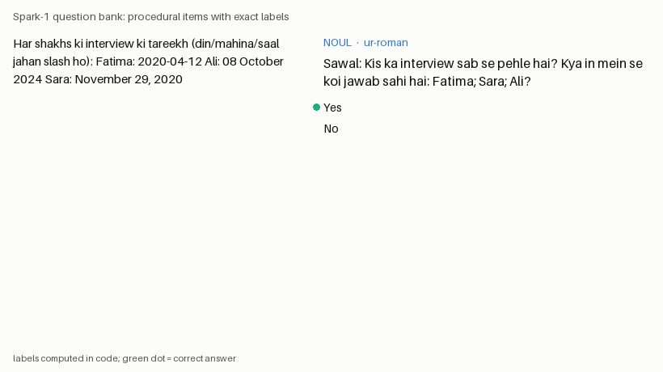

# Spark-1

An open, calibrated "System One" model. Spark-1 answers four kinds of questions over text
and images and returns **probabilities, never free text**:

| primitive | asks | returns |
|---|---|---|
| **Choice** | which of 2–10 options fits | a probability per option, the top option, confidence |
| **Noul** | is this statement true | one probability of "yes" |
| **Score** | which of 2–10 ordered levels | a probability per level, the expected level, confidence |
| **Box** | where is this thing in the image | top/left/bottom/right as fractions of the image |

Confidence for Choice is `(n * p_top - 1) / (n - 1)`; for Score it is a spread statistic
(see `spark_one/confidence.py`). Neither is "probability of being right"; calibration is
measured separately.

The primitives, request shape and confidence statistics follow the public documentation of
TypeSafe's System One model Jev (https://docs.typesafe.ai). Credit for the idea goes to
TypeSafe; Spark-1 is an independent open project and is not affiliated with or endorsed by them.



## How it is built

```
procedural generators ──► question bank (exact labels, provenance, splits)
                               │
           Gemma 4 31B teacher on vLLM ──► option-token logprobs (soft labels)
                               │
             Gemma 4 E2B + LoRA student: KL to teacher + log loss on exact labels,
             logits read at answer tokens only, Box as 4 binned coordinate steps
                               │
          temperature scaling on val ──► eval harness ──► POST /v1/systemone
```

**Data rule.** Training data comes only from code with exact ground truth, or from the
Gemma 4 31B teacher on the Spark. Outputs of Claude, OpenAI, Gemini or Jev are never used
for training; the adapters in `spark_one/adapters/` exist only to evaluate them, behind a
hard cost cap.

## What is in the repo

| path | what |
|---|---|
| `spark_one/schema.py`, `bank.py` | item schema, option shuffling, "none fits" cases with companion Nouls, scene-grouped splits, provenance |
| `spark_one/generators/` | text tasks in English and Roman Urdu, shape scenes, chat / settings / cart screenshots, bar / line / pie charts, Box targets, optical illusions (eval only) |
| `spark_one/steps.py`, `prompt.py` | every primitive as categorical answer steps; one prompt format for all models |
| `spark_one/teacher/` | teacher-score job (vLLM logprobs → soft labels), fake vLLM server for tests |
| `spark_one/train/` | the shared answer-token loss and the Gemma 4 E2B LoRA trainer (checkpoint + resume) |
| `spark_one/tiny/` | a tiny random-init transformer that proves the whole loop on CPU |
| `spark_one/calibrate.py`, `eval/` | temperature scaling; accuracy, ECE, Brier, log loss, reliability, accuracy vs coverage, option-order and negation consistency, latency, Box IoU; EN / Roman Urdu / text / image slices |
| `spark_one/serve/` | FastAPI `POST /v1/systemone` with prefix caching |
| `spark_one/adapters/` | eval-only Jev and OpenRouter adapters with a cost cap |
| `jobs/` | spark-lab job files for every Spark stage |
| `runs/tiny/` | results, figures and logs of the CPU run (see `runs/tiny/RESULTS.md`) |
| `HANDOFF.md` | status, Spark setup, remaining work |

## Quickstart (CPU)

```bash
pip install --index-url https://download.pytorch.org/whl/cpu torch
pip install -e '.[dev]'
python -m spark_one.build --out data/generated/bank --n 1500 --seed 1     # ~4 min, 110k items
pytest -q
bash scripts/run_tiny_loop.sh                                             # tiny teacher -> students -> eval
```

Serve a checkpoint:

```bash
SPARK1_BACKEND=tiny SPARK1_CKPT=runs/tiny/student_kd/final.pt SPARK1_TEMPS=runs/tiny/student_kd/temps.json \
  uvicorn spark_one.serve.app:app --port 8100
```

```bash
curl -s localhost:8100/v1/systemone -H 'content-type: application/json' -d '{
  "state": "Ali has 7 books. Sara has 4 books.",
  "questions": {
    "more": {"type": "choice", "instructions": "Who has more books?", "criteria": {"Ali": null, "Sara": null}},
    "ali":  {"type": "noul", "instructions": "Does Ali have more books than Sara?"}
  }}'
```

On the DGX Spark the same commands run against Gemma 4; see `HANDOFF.md`.

## Results

The CPU run uses tiny models to prove the pipeline end to end; it says nothing about how
good Gemma-based Spark-1 will be. Its numbers live in [`runs/tiny/RESULTS.md`](runs/tiny/RESULTS.md),
generated from the harness reports. Gemma results will land in `runs/` from the Spark jobs.

## License

Code: Apache-2.0. Generated data: produced by the generators in this repo, free to use.
